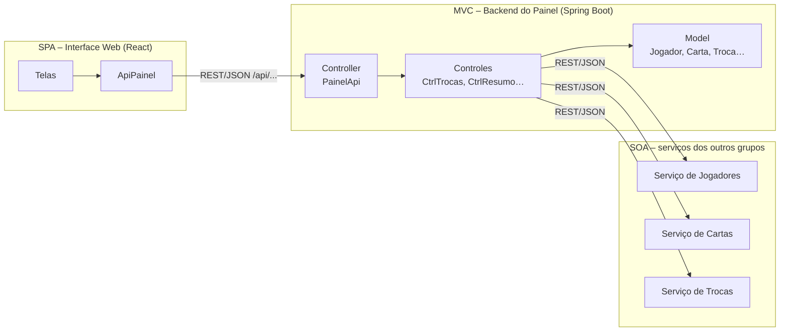

# 06 – Arquitetura

Visão global do sistema representada com os diagramas estruturais da UML.

## Diagrama de componentes

Mostra as partes do software, sua organização e as dependências entre elas.

| Componente | Responsabilidade |
|---|---|
| **Interface Web do Painel** | as telas («boundary») que o administrador usa |
| **Backend do Painel** | os controles («control») e as fronteiras com os serviços dos outros grupos |
| **Serviços de Jogadores, Cartas e Trocas** | componentes dos outros grupos, que fornecem os dados |

## Diagrama de implantação

Mostra como e onde o sistema é implantado: os dispositivos, o que roda em cada um e como eles
se comunicam.

## Padrões arquiteturais

O painel se baseia na **SOA (Arquitetura Orientada a Serviços)**. Dentro dela, a Interface Web é uma
**SPA** e o backend é organizado em **MVC**.

| Padrão | Papel no projeto | Onde aparece |
|---|---|---|
| [**SOA**](#soa--arquitetura-orientada-a-serviços) | base da plataforma | serviços de Jogadores, Cartas e Trocas, consumidos pelo backend do painel por REST/JSON |
| [**SPA**](#spa--single-page-application) | Interface Web | telas em React, que trocam só JSON com o backend |
| [**MVC**](#mvc--model-view-controller) | organização do backend | `PainelApi` → controles → entidades |

### SOA – Arquitetura Orientada a Serviços

> **Padrão: SOA** · Onde: a plataforma inteira; o painel é um **consumidor** dos serviços

**Contexto.** A plataforma de cartas Pokémon é dividida entre vários grupos. Cada grupo é dono de
uma parte dos dados: Jogadores (contas e login), Cartas (as cartas de cada jogador) e Trocas
(trocas e propostas). O painel precisa mostrar um pouco de tudo, mas não é dono de nenhum desses
dados.

**Problema.** Se o painel acessasse direto o banco de cada grupo, ou copiasse os dados para um
banco próprio:

- ficaria **acoplado** à estrutura interna de cada grupo, e qualquer mudança no banco de outro
  grupo quebraria o painel;
- os dados copiados ficariam **duplicados e desatualizados**;
- cada grupo perderia o controle de quem lê e altera os seus dados.

**Solução.** Cada grupo expõe o seu **serviço** por REST/JSON, com um contrato combinado entre as
equipes, e o painel só **consome** esses serviços:

| Serviço | O que o painel usa |
|---|---|
| Jogadores | `POST /login` (autentica o administrador) e `GET /jogadores` |
| Cartas | `GET /cartas` (todas as cartas, em uma consulta só) |
| Trocas | `GET /trocas` (trocas com as suas propostas) |
| PokéAPI (externo) | nome, tipos e imagem de cada Pokémon |

No código, cada serviço é acessado por uma interface própria (`IServicoJogadores`,
`IServicoCartas`, `IServicoTrocas`, `IServicoPokemon`). Se o contrato de um grupo mudar, só o
cliente daquele serviço muda. O painel não tem banco: a informação sempre vem do grupo
responsável. Os serviços são independentes entre si e podem ser implantados em servidores
diferentes, como mostra o diagrama de implantação.

### SPA – Single Page Application

> **Padrão: SPA** · Onde: a Interface Web do painel, em **React**

**Contexto.** Depois do login, o administrador navega entre seis abas: resumo, jogadores, cartas,
trocas em aberto, propostas e histórico. Todas usam o mesmo cabeçalho e o mesmo menu.

**Problema.** Em uma aplicação de várias páginas, cada clique em uma aba carregaria uma página
inteira do servidor: o HTML, o menu e os estilos de novo, só para mudar a tabela do meio. Além
disso, se o navegador chamasse direto os serviços dos outros grupos, cada um deles precisaria
liberar o acesso (CORS) e o navegador teria que conhecer o endereço de todos.

**Solução.** A Interface Web é carregada **uma vez**. Ao trocar de aba, o React troca só o
componente da tela (`react-router-dom`), e os dados chegam como **JSON** pela `ApiPainel`:

- cada tela pede os dados à `ApiPainel`, que chama uma rota do backend (`/api/trocas/abertas`, por
  exemplo);
- o token do administrador fica guardado na `ApiPainel` e vai em todas as requisições;
- o navegador fala **só com o backend do painel**. Quem conversa com os outros grupos é o backend,
  e por isso os serviços deles não precisam liberar CORS para o navegador.

### MVC – Model-View-Controller

> **Padrão: MVC** · Onde: dentro do **backend do painel**, em Spring Boot

**Contexto.** Cada requisição da Interface Web passa por três etapas: receber o pedido HTTP e
conferir a sessão, buscar e combinar os dados dos serviços, e devolver o resultado em JSON.

**Problema.** Se tudo ficasse no mesmo lugar, cada rota misturaria HTTP, chamadas aos outros
grupos e regras de contagem e agrupamento. A mesma regra (por exemplo, "quantas propostas
pendentes existem") seria repetida em várias rotas, e não daria para testar a lógica sem subir o
servidor.

**Solução.** O backend separa as responsabilidades em camadas:

| Camada | No painel | Responsabilidade |
|---|---|---|
| **Controller** | `PainelApi` e `AutenticacaoApi` (`@RestController`) | recebe a requisição, chama o controle certo e devolve JSON |
| **Lógica** (controles) | `CtrlResumo`, `CtrlJogadores`, `CtrlCartasJogadores`, `CtrlTrocas`, `CtrlAutenticacao` | junta, conta e agrupa os dados dos serviços |
| **Model** | `Jogador`, `Carta`, `Troca`, `Proposta`, `Sessao`, `ResumoPainel` | as informações, só com getters |
| **View** | a resposta JSON, desenhada pelas telas da SPA | mostra os dados ao administrador |

As camadas correspondem às classes de análise do [diagrama de classes](../03-diagrama-de-classes/README.md):
«boundary» (telas e clientes dos serviços), «control» (controles) e «entity» (entidades). Os
controles não conhecem HTTP nem o Spring e são testados sozinhos, com serviços falsos.

### Padrão arquitetural que não usamos

- **MOM (mensageria, como MQTT):** serviria para atualizar as telas em tempo real quando uma troca
  mudasse. O painel é **somente leitura** e consulta os dados quando o administrador abre uma aba,
  então não há necessidade de um broker de mensagens. Se o grupo de Trocas passar a publicar
  eventos, as telas de trocas e propostas poderiam assinar esses eventos sem mudar o resto da
  arquitetura.

## Decisões e trade-offs

| Decisão | Alternativa considerada | Motivo da escolha |
|---|---|---|
| Ter um **backend próprio do painel** entre as telas e os outros serviços | As telas consultarem direto os serviços dos outros grupos | (+) Um único lugar junta os dados e conhece os serviços dos outros grupos. (+) As telas recebem os dados prontos. (−) É mais um componente para implantar. |
| Buscar as cartas com **uma consulta** e agrupar no painel | Uma consulta por jogador | Com N jogadores, seriam N+1 consultas. Uma só é mais rápida e menos sujeita a falhas (RNF04). |
| Painel **somente leitura**, sem banco próprio | Copiar os dados para um banco do painel | Evita dados duplicados e desatualizados. A informação sempre vem do grupo responsável. |
