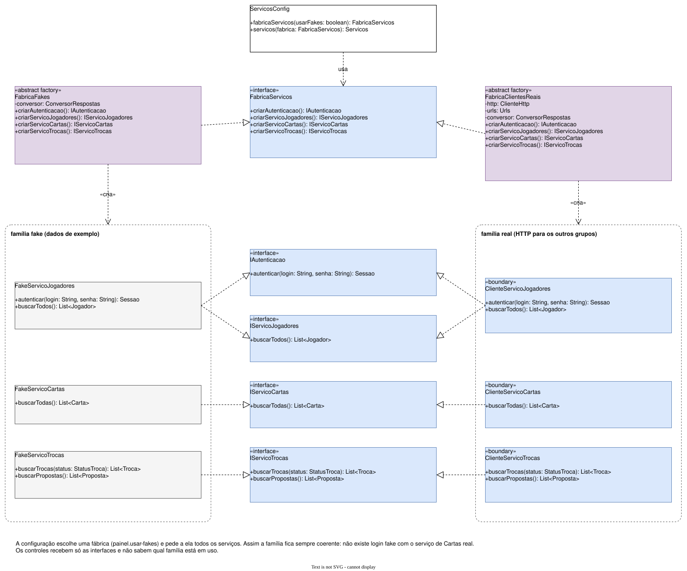
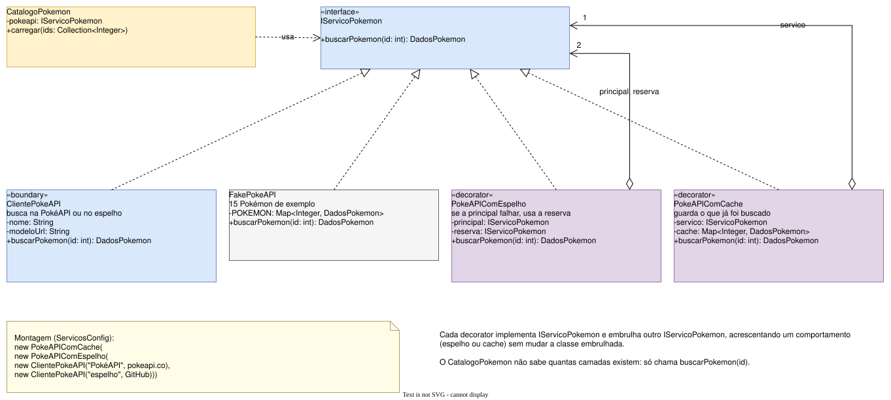

# 08 – Padrões de Projeto

Um padrão de projeto é uma **solução já testada para um problema que se repete em um contexto**.
Ele não é um código pronto: é uma forma de organizar as classes que outras equipes já usaram com
sucesso. Os padrões se dividem em três tipos:

- **Criação:** como os objetos são criados.
- **Estrutural:** como as classes e os objetos se combinam.
- **Comportamental:** como os objetos dividem as responsabilidades e se comunicam.

| Tipo | Padrão | Onde está no código |
|---|---|---|
| Criação | [**Abstract Factory**](#abstract-factory) | `FabricaServicos`, `FabricaFakes`, `FabricaClientesReais` |
| Estrutural | [**Decorator**](#decorator) | `PokeAPIComEspelho`, `PokeAPIComCache` |
| Estrutural | [**Adapter**](#adapter) | `ClienteServicoJogadores`, `ClienteServicoCartas`, `ClienteServicoTrocas`, `ConversorRespostas` |
| Estrutural | [**Facade**](#facade) | `ApiPainel` (Interface Web) e `PainelApi` (backend) |
| Comportamental | [**Strategy**](#strategy) | versões falsa e real de cada interface de serviço |
| Comportamental | [**Chain of Responsibility**](#chain-of-responsibility) | `FiltroDeSessao` |

Cada padrão está descrito em três partes: **contexto** (o que o código precisa fazer), **problema**
(por que a forma anterior, ou a forma sem o padrão, não era a melhor) e **solução** (como o padrão
foi aplicado). Nos diagramas, as classes em **lilás** são as que formam o padrão; as outras cores
seguem as do [diagrama de classes](../03-diagrama-de-classes/README.md).

---

## Padrões de criação

### Abstract Factory

> **Padrão: Abstract Factory** · Tipo: **Criação** · Classes: `FabricaServicos`, `FabricaFakes`, `FabricaClientesReais`



**Contexto.** O painel conversa com quatro serviços dos outros grupos: autenticação, jogadores,
cartas e trocas. Enquanto os grupos não terminam os seus serviços, o painel usa versões falsas com
dados de exemplo. A propriedade `painel.usar-fakes` diz qual das duas famílias usar: toda falsa ou
toda real.

**Problema.** O `ServicosConfig` tinha um `if (usarFakes)` e montava cada serviço nos dois ramos:

- Nada impedia de **misturar as famílias**, por exemplo um login falso com o serviço de Cartas
  real, o que quebraria o token.
- Cada serviço novo precisava ser lembrado **nos dois ramos** do `if`.
- A configuração conhecia todas as classes concretas: `FakeServicoCartas`, `ClienteServicoCartas`,
  `ClienteHttp`…

**Solução.** A interface `FabricaServicos` declara um método de criação para cada serviço, e cada
família tem a sua fábrica:

| Classe | Papel no padrão | Cria |
|---|---|---|
| `FabricaServicos` | fábrica abstrata | contrato: `criarAutenticacao()`, `criarServicoJogadores()`, `criarServicoCartas()`, `criarServicoTrocas()` |
| `FabricaFakes` | fábrica concreta | `FakeServicoJogadores`, `FakeServicoCartas`, `FakeServicoTrocas` |
| `FabricaClientesReais` | fábrica concreta | `ClienteServicoJogadores`, `ClienteServicoCartas`, `ClienteServicoTrocas`, todos com o mesmo `ClienteHttp` |
| `IAutenticacao`, `IServicoJogadores`, `IServicoCartas`, `IServicoTrocas` | produtos abstratos | o que os controles conhecem |

O `ServicosConfig` escolhe a fábrica **uma vez** e pede a ela todos os serviços:

```java
FabricaServicos fabrica = usarFakes
        ? new FabricaFakes(conversor)
        : new FabricaClientesReais(TokenDaRequisicao::atual, urls, conversor);
```

Assim a família fica sempre coerente, e uma família nova (por exemplo, os serviços de homologação
de um grupo) é só uma fábrica nova. O custo: um **tipo** novo de serviço obriga a mudar a interface
e todas as fábricas.

---

## Padrões estruturais

### Decorator

> **Padrão: Decorator** · Tipo: **Estrutural** · Classes: `PokeAPIComEspelho`, `PokeAPIComCache`



**Contexto.** Cada carta mostra o nome, os tipos e a imagem do Pokémon, que vêm da PokéAPI. Em
algumas redes, como a da faculdade, o site `pokeapi.co` é bloqueado, e por isso o painel usa um
espelho da PokéAPI no GitHub. Como as mesmas cartas aparecem em várias telas, o painel também
guarda em cache o que já buscou.

**Problema.** A classe `ClientePokeAPI` fazia três coisas ao mesmo tempo:

- a requisição HTTP;
- o cache dos Pokémon já buscados;
- a troca para o espelho quando a PokéAPI falhava.

Eram três motivos para mudar a mesma classe (fere a responsabilidade única). Não dava para ter
cache sem espelho, ou o contrário, e para testar o cache era preciso ter internet.

**Solução.** Cada comportamento virou uma classe que **implementa** `IServicoPokemon` e
**embrulha** outro `IServicoPokemon`:

| Classe | Papel no padrão | O que faz |
|---|---|---|
| `IServicoPokemon` | componente | contrato: `buscarPokemon(id)` |
| `ClientePokeAPI` | componente concreto | só faz a requisição para uma URL (PokéAPI ou espelho) |
| `FakePokeAPI` | componente concreto | tabela local com 15 Pokémon, para rodar sem internet |
| `PokeAPIComEspelho` | decorator | tenta o serviço principal e, se ele falhar, usa o reserva |
| `PokeAPIComCache` | decorator | devolve o que já foi buscado sem chamar o serviço de novo |

As camadas são montadas no `ServicosConfig`:

```java
new PokeAPIComCache(
        new PokeAPIComEspelho(
                new ClientePokeAPI("PokéAPI", url + "/pokemon/{id}"),
                new ClientePokeAPI("espelho da PokéAPI", urlEspelho + "/pokemon/{id}/index.json")));
```

O `CatalogoPokemon` continua chamando só `buscarPokemon(id)`, sem saber quantas camadas existem.
Um comportamento novo, como um limite de tempo, entra como outro decorator. Cada camada é testada
sem internet (`DecoradoresPokeAPITest`). O cuidado: a **ordem** importa. Com o cache por fora, o
que veio do espelho também fica guardado.

### Adapter

> **Padrão: Adapter** · Tipo: **Estrutural** · Classes: `ClienteServicoJogadores`, `ClienteServicoCartas`, `ClienteServicoTrocas`, `ConversorRespostas`

**Contexto.** Os dados do painel vêm dos serviços de três grupos diferentes. Cada grupo define as
suas rotas e o formato do seu JSON.

**Problema.** Sem uma camada no meio, os controles teriam que montar URLs e ler o JSON de cada
grupo. Qualquer mudança no contrato de um grupo (um campo renomeado, uma rota nova) espalharia
alterações pelos controles e pelas telas.

**Solução.** Os controles usam só as interfaces do painel (`IServicoJogadores`, `IServicoCartas`,
`IServicoTrocas`). Cada `ClienteServico*` **adapta** um serviço externo a uma dessas interfaces: faz
a requisição, recebe o JSON e, com o `ConversorRespostas`, transforma a resposta nas entidades do
painel (`Jogador`, `Carta`, `Troca`, `Proposta`). Se o contrato de um grupo mudar, só o adaptador
daquele serviço muda.

### Facade

> **Padrão: Facade** · Tipo: **Estrutural** · Classes: `ApiPainel` (Interface Web) e `PainelApi` (backend)

**Contexto.** Para mostrar uma tela, o painel precisa de login, token, URLs, tratamento de sessão
expirada e de dados vindos de vários serviços.

**Problema.** Se cada tela fizesse as suas requisições, todas repetiriam o mesmo código de token e
de erro e conheceriam detalhes que não são delas. Na Interface Web, isso também obrigaria a tela a
chamar vários serviços e juntar os dados sozinha.

**Solução.** Uma fachada em cada lado esconde esses detalhes:

- **`ApiPainel`** (Interface Web): é a única porta das telas para o backend. Guarda o token, faz o
  `fetch` e avisa quando a sessão expirou. A tela só chama, por exemplo, `api.trocasAbertas()`.
- **`PainelApi`** (backend): oferece **uma rota por tela** (`/api/resumo`, `/api/jogadores`,
  `/api/trocas/abertas`…), com os dados já juntados pelos controles.

---

## Padrões comportamentais

### Strategy

> **Padrão: Strategy** · Tipo: **Comportamental** · Classes: versões falsa e real de `IServicoJogadores`, `IServicoCartas`, `IServicoTrocas` e `IServicoPokemon`

**Contexto.** O painel precisa funcionar em dois cenários: com os dados de exemplo, enquanto os
outros grupos desenvolvem os seus serviços, e com os serviços reais. A PokéAPI também tem uma
versão local, para rodar sem internet.

**Problema.** Sem o padrão, cada controle teria um `if` para decidir de onde buscar os dados.
Trocar de cenário obrigaria a mexer em todos os controles, e os testes dependeriam dos serviços dos
outros grupos estarem no ar.

**Solução.** Cada interface de serviço é a "família de algoritmos", e cada implementação é uma
estratégia **intercambiável**:

| Interface | Estratégia falsa | Estratégia real |
|---|---|---|
| `IServicoJogadores` | `FakeServicoJogadores` | `ClienteServicoJogadores` |
| `IServicoCartas` | `FakeServicoCartas` | `ClienteServicoCartas` |
| `IServicoTrocas` | `FakeServicoTrocas` | `ClienteServicoTrocas` |
| `IServicoPokemon` | `FakePokeAPI` | `ClientePokeAPI` (com os decorators) |

Os controles recebem a interface pelo construtor e não sabem qual estratégia está em uso. A escolha
fica na configuração, pela fábrica.

### Chain of Responsibility

> **Padrão: Chain of Responsibility** · Tipo: **Comportamental** · Classe: `FiltroDeSessao`

**Contexto.** Todas as rotas do painel, menos o login, só podem ser acessadas por um administrador
com sessão válida.

**Problema.** Sem o padrão, cada método da `PainelApi` teria que começar conferindo o token. Seria
o mesmo código repetido em seis lugares, e bastaria esquecer em uma rota para ela ficar aberta.

**Solução.** O `FiltroDeSessao` é um **elo** da cadeia de interceptadores do Spring, registrado em
`/api/**` (menos `/api/login`). Cada requisição passa por ele antes de chegar na `PainelApi`:

- **token válido:** o filtro guarda o token para os clientes usarem e passa a requisição adiante;
- **sem token ou token inválido:** a cadeia para ali e a resposta é `401`.

---

## Padrões que não usamos, e por quê

- **Singleton:** o Spring já cria uma instância só de cada bean. Escrever um Singleton à mão
  repetiria isso e dificultaria os testes.
- **Observer:** o painel consulta os dados quando o administrador abre uma aba. Não há eventos em
  tempo real para observar.
- **Builder:** `ResumoPainel` tem só cinco campos, e um construtor basta.

## Padrões e princípios

| Padrão | Princípios que reforça |
|---|---|
| Abstract Factory | aberto/fechado, inversão de dependência |
| Decorator | responsabilidade única, aberto/fechado |
| Adapter | ocultamento de informação, baixo acoplamento |
| Facade | Demeter, baixo acoplamento |
| Strategy | substituição de Liskov, inversão de dependência |
| Chain of Responsibility | responsabilidade única |

Os princípios estão explicados em [07-principios-de-projeto](../07-principios-de-projeto/README.md).
