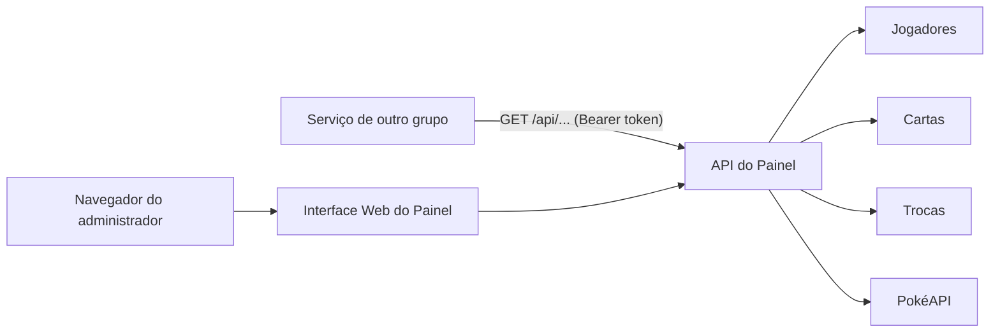

# 09 – Integração: como usar o Painel de Administração

Guia para os outros grupos da plataforma usarem o **Painel de Administração**.

O painel junta, em um lugar só, as informações gerais da plataforma: jogadores e as suas cartas,
trocas em aberto, propostas e histórico de trocas. Ele pode ser usado de duas formas:

- pela **Interface Web**, para olhar os dados nas telas;
- pela **API do painel**, para o serviço de vocês consultar os dados já prontos (com nicks, nomes
  dos Pokémon, tipos e imagens).

O painel é **somente leitura**: nenhuma rota altera dados.

## O que o painel oferece

| Informação | Tela | Rota da API |
|---|---|---|
| Totais da plataforma | Resumo geral | `GET /api/resumo` |
| Jogadores e quantas cartas cada um tem | Jogadores | `GET /api/jogadores` |
| Cartas de cada jogador, com nome, tipos e imagem do Pokémon | Cartas dos jogadores | `GET /api/cartas` |
| Trocas em aberto, há quanto tempo e quantas propostas | Trocas em aberto | `GET /api/trocas/abertas` |
| Propostas de troca e o status de cada uma | Propostas | `GET /api/propostas` |
| Trocas finalizadas: quem trocou o quê com quem | Histórico de trocas | `GET /api/trocas/historico` |



O painel consulta Jogadores, Cartas, Trocas e a PokéAPI e devolve tudo **junto e pronto para
mostrar**. Por exemplo, em vez de `ofertanteId: "j-001"` e `pokemonId: 25`, a resposta já traz
`nickOfertante: "ashketchum"` e a carta com nome, tipos e imagem.

## Quem pode usar

Só usuários com perfil **`ADMIN`** no serviço de Jogadores. O login do painel é o mesmo login da
plataforma: o painel confere o usuário e a senha no serviço de Jogadores e só libera quem tem esse
perfil.

Enquanto os serviços dos grupos não estão prontos, o painel roda com **dados de exemplo**. Nesse
modo, o login de administrador é `admin` / `admin`. O usuário `ash` / `ash` é um jogador comum e
recebe "acesso negado".

## Usando pela Interface Web

1. Abra o endereço da Interface Web do painel.
2. Entre com um usuário administrador.
3. Navegue pelas abas: **Resumo**, **Jogadores**, **Cartas**, **Trocas em aberto**, **Propostas**
   e **Histórico**.

Se um serviço estiver fora do ar, só a aba que depende dele mostra um aviso. As outras continuam
funcionando.

## Usando pela API

- **Endereço base:** `http://<servidor-do-painel>:8080/api`
- **Formato:** JSON, campos em camelCase, datas em ISO-8601 (UTC)
- **Autenticação:** todas as rotas, menos o login, exigem o cabeçalho
  `Authorization: Bearer <token>`
- **De onde chamar:** do **backend** de vocês. Se precisarem chamar direto do navegador (de um
  front-end), avisem o grupo do painel para liberarmos o endereço de vocês (CORS).

### 1. Login – `POST /api/login`

```json
{ "login": "admin", "senha": "admin" }
```

Resposta `200`:

```json
{ "token": "token-fake-admin" }
```

Use esse `token` em todas as outras chamadas. Ele vale até o logout (`POST /api/logout`).

Login errado ou usuário sem perfil `ADMIN`: `401`

```json
{ "mensagem": "Acesso negado: login ou senha inválidos, ou usuário sem perfil de administrador." }
```

Exemplo completo com `curl`:

```bash
curl -X POST http://localhost:8080/api/login -H "Content-Type: application/json" -d "{\"login\":\"admin\",\"senha\":\"admin\"}"
```

```bash
curl http://localhost:8080/api/resumo -H "Authorization: Bearer token-fake-admin"
```

### 2. Resumo geral – `GET /api/resumo`

```json
{
  "totalJogadores": 3,
  "totalCartas": 15,
  "trocasAbertas": 2,
  "propostasPendentes": 2,
  "trocasFinalizadas": 1
}
```

Se um serviço não responder, os totais que dependem dele vêm como `null` e o resto vem
normalmente.

### 3. Jogadores – `GET /api/jogadores`

```json
[
  {
    "id": "j-001",
    "nick": "ashketchum",
    "email": "ash@exemplo.com",
    "dataCadastro": "2026-09-10T12:00:00Z",
    "quantidadeCartas": 5
  }
]
```

### 4. Cartas dos jogadores – `GET /api/cartas`

Uma entrada por jogador, com as cartas que ele tem hoje:

```json
[
  {
    "jogador": { "id": "j-001", "nick": "ashketchum" },
    "cartas": [
      {
        "id": "c-101",
        "pokemonId": 25,
        "nome": "pikachu",
        "tipos": ["electric"],
        "imagemUrl": "https://raw.githubusercontent.com/PokeAPI/sprites/master/sprites/pokemon/other/official-artwork/25.png"
      }
    ]
  }
]
```

Todas as cartas das respostas do painel têm esse mesmo formato: `id`, `pokemonId`, `nome`, `tipos`
e `imagemUrl`.

### 5. Trocas em aberto – `GET /api/trocas/abertas`

```json
[
  {
    "id": "t-500",
    "nickOfertante": "ashketchum",
    "cartaOferecida": { "id": "c-101", "pokemonId": 25, "nome": "pikachu", "tipos": ["electric"], "imagemUrl": "..." },
    "dataAbertura": "2026-09-30T18:00:00Z",
    "tempoEmAbertoMs": 4085468199,
    "quantidadePropostas": 2
  }
]
```

`tempoEmAbertoMs` é o tempo desde a abertura, em milissegundos.

### 6. Propostas – `GET /api/propostas`

```json
[
  {
    "id": "p-900",
    "trocaId": "t-480",
    "nickProponente": "ashketchum",
    "cartaProposta": { "id": "c-102", "pokemonId": 4, "nome": "charmander", "tipos": ["fire"], "imagemUrl": "..." },
    "status": "ACEITA",
    "dataProposta": "2026-09-28T12:10:00Z"
  }
]
```

`status`: `PENDENTE`, `ACEITA` ou `RECUSADA`.

### 7. Histórico de trocas – `GET /api/trocas/historico`

```json
[
  {
    "id": "t-480",
    "dataFinalizacao": "2026-09-28T15:42:00Z",
    "nickOfertante": "misty",
    "cartaOferecida": { "id": "c-140", "pokemonId": 7, "nome": "squirtle", "tipos": ["water"], "imagemUrl": "..." },
    "nickReceptor": "ashketchum",
    "cartaRecebida": { "id": "c-102", "pokemonId": 4, "nome": "charmander", "tipos": ["fire"], "imagemUrl": "..." }
  }
]
```

- `nickOfertante` colocou a `cartaOferecida` para troca.
- `nickReceptor` é quem fez a proposta aceita: ficou com a `cartaOferecida` e deu a
  `cartaRecebida`.
- Sem proposta aceita, `nickReceptor` vem como `"—"` e `cartaRecebida` como `null`.

### Erros

| Código | Quando | Corpo |
|---|---|---|
| `401` | sem token, token inválido ou login errado | `{ "mensagem": "..." }` |
| `503` | um serviço dos outros grupos está fora do ar | `{ "mensagem": "..." }` com o nome do serviço |

## Exemplos de uso por grupo

| Grupo | Para que usar o painel | Rotas |
|---|---|---|
| **Jogadores** | Conferir quantos jogadores existem e se cada jogador novo recebeu as suas cartas | `/api/jogadores`, `/api/resumo` |
| **Cartas** | Conferir a distribuição: quais cartas cada jogador tem, já com nome, tipos e imagem do Pokémon | `/api/cartas`, `/api/resumo` |
| **Trocas** | Acompanhar trocas abertas e propostas, e conferir se, depois de uma troca, as cartas mudaram de dono | `/api/trocas/abertas`, `/api/propostas`, `/api/trocas/historico` e `/api/cartas` |
| **Qualquer grupo** | Mostrar números gerais da plataforma ou testar se o seu serviço está entregando os dados certos | `/api/resumo` |

A última linha é útil durante o desenvolvimento: se os dados do seu serviço aparecem certos no
painel, o contrato combinado está funcionando.

## Para os seus dados aparecerem no painel

O painel monta as respostas acima a partir destas rotas dos serviços de cada grupo:

| Grupo | Rota que o painel consulta | Campos que o painel usa |
|---|---|---|
| Jogadores | `POST /auth/login` | `token`, `jogadorId`, `perfil` (`ADMIN` ou `JOGADOR`) |
| Jogadores | `GET /jogadores` | `id`, `nick`, `email`, `dataCadastro` |
| Cartas | `GET /cartas` | `id`, `jogadorId` (dono atual), `pokemonId`, `dataRecebimento` |
| Trocas | `GET /trocas` e `GET /trocas?status=` | `id`, `ofertanteId`, `cartaOferecida { id, pokemonId }`, `status`, `dataAbertura`, `dataFinalizacao` e a lista `propostas` |
| Trocas | `GET /propostas` | `id`, `trocaId`, `proponenteId`, `cartaProposta { id, pokemonId }`, `status`, `dataProposta` |

- O painel envia o token do administrador (`Authorization: Bearer <token>`) em todas essas
  consultas.
- Nome, tipos e imagem vêm da PokéAPI: basta mandar o `pokemonId`.
- Campos a mais são ignorados. Listas vazias devem vir como `[]`.

Se alguma rota ou campo do seu serviço for diferente, avise o grupo do painel. A mudança fica só no
cliente daquele serviço e não afeta o resto do painel nem quem usa a API do painel.
