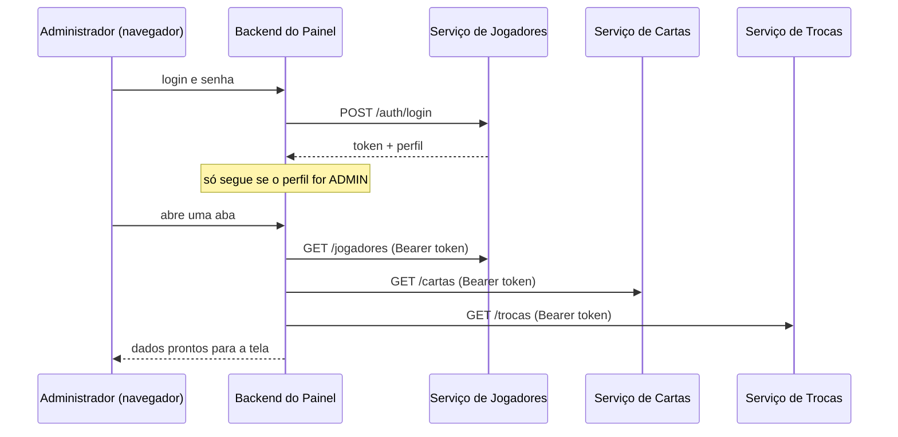

# 09 – Integração com o Painel de Administração

Guia para os grupos de **Jogadores**, **Cartas** e **Trocas**. Ele mostra o que o Painel de
Administração precisa de cada serviço para mostrar as informações da plataforma.

O painel é **somente leitura**. Ele não tem banco próprio e não altera nada nos outros serviços:
faz só o login do administrador e consultas `GET`.

## Como o painel se conecta



- Quem chama os serviços é o **backend do painel**, nunca o navegador. Por isso **não é preciso
  liberar CORS** para o painel.
- Todas as consultas levam o token do administrador no cabeçalho
  `Authorization: Bearer <token>`. É o mesmo token devolvido pelo serviço de Jogadores no login.
- Nome, tipos e imagem de cada Pokémon vêm da **PokéAPI**. Os serviços só precisam informar o
  `pokemonId` (número da Pokédex) de cada carta.

## Convenções

| Item | Combinado |
|---|---|
| Estilo | REST sobre HTTP, corpo em JSON |
| Nomes dos campos | camelCase, exatamente como nas tabelas abaixo |
| Identificadores | `String` (ex.: `"j-001"`, `"c-101"`, `"t-500"`) |
| Número do Pokémon | `pokemonId`, inteiro da Pokédex nacional (ex.: `25` = Pikachu) |
| Datas | ISO-8601 em UTC, com `Z` no final (ex.: `"2026-10-01T14:30:00Z"`) |
| Status | texto em maiúsculas, com os valores exatos listados em cada serviço |
| Campos a mais | podem existir: o painel **ignora** o que não usa |
| Listas vazias | devolver `[]` com `200`, e não `404` |

## Serviço de Jogadores

### `POST /auth/login` – autenticar o administrador

Requisição:

```json
{ "login": "admin", "senha": "admin" }
```

Resposta `200`:

```json
{ "token": "eyJhbGciOi...", "jogadorId": "j-000", "perfil": "ADMIN" }
```

| Campo | Tipo | Obrigatório | Uso no painel |
|---|---|---|---|
| `token` | String | sim | enviado em todas as consultas aos três serviços |
| `jogadorId` | String | sim | identifica quem está logado |
| `perfil` | String | sim | `"ADMIN"` ou `"JOGADOR"`. Só `ADMIN` entra no painel; `JOGADOR` recebe "acesso negado". |

Login ou senha errados: responder **`401`**.

### `GET /jogadores` – lista de jogadores

Usado em quase todas as telas, para trocar o id de cada jogador pelo **nick**.

```json
[
  { "id": "j-001", "nick": "ashketchum", "email": "ash@exemplo.com", "dataCadastro": "2026-09-10T12:00:00Z" },
  { "id": "j-002", "nick": "misty", "email": "misty@exemplo.com", "dataCadastro": "2026-09-11T09:30:00Z" }
]
```

| Campo | Tipo | Obrigatório | Uso no painel |
|---|---|---|---|
| `id` | String | sim | liga o jogador às cartas, trocas e propostas |
| `nick` | String | sim | nome mostrado em todas as telas |
| `email` | String | não | lista de jogadores |
| `dataCadastro` | data | não | lista de jogadores |

## Serviço de Cartas

### `GET /cartas` – todas as cartas, com o dono atual

O painel faz **uma consulta só** e agrupa as cartas por jogador. Assim não é preciso uma chamada
por jogador.

```json
[
  { "id": "c-101", "jogadorId": "j-001", "pokemonId": 25, "dataRecebimento": "2026-09-10T12:00:05Z" },
  { "id": "c-140", "jogadorId": "j-001", "pokemonId": 7, "dataRecebimento": "2026-09-28T15:42:00Z" }
]
```

| Campo | Tipo | Obrigatório | Uso no painel |
|---|---|---|---|
| `id` | String | sim | identifica a carta |
| `jogadorId` | String | sim | dono **atual** da carta. Depois de uma troca, precisa mostrar o novo dono. |
| `pokemonId` | int | sim | o painel busca nome, tipos e imagem na PokéAPI |
| `dataRecebimento` | data | não | quando o jogador recebeu a carta |

Se o serviço já guardar `nome`, `tipos` ou `imagemUrl`, pode mandar: esses campos são ignorados,
porque o painel usa a PokéAPI.

## Serviço de Trocas

Valores de status:

- **Troca:** `ABERTA`, `FINALIZADA`, `CANCELADA`
- **Proposta:** `PENDENTE`, `ACEITA`, `RECUSADA`

### `GET /trocas` – trocas, cada uma com as suas propostas

O painel chama sem filtro (resumo geral) e com o filtro `?status=ABERTA` ou `?status=FINALIZADA`.

**Importante:** cada troca precisa vir **com a lista das suas propostas** no campo `propostas`. É
com ela que o painel conta as propostas pendentes e descobre qual proposta foi aceita, sem fazer
uma consulta por troca.

```json
[
  {
    "id": "t-480",
    "ofertanteId": "j-002",
    "cartaOferecida": { "id": "c-140", "pokemonId": 7 },
    "status": "FINALIZADA",
    "dataAbertura": "2026-09-28T10:00:00Z",
    "dataFinalizacao": "2026-09-28T15:42:00Z",
    "propostas": [
      {
        "id": "p-900",
        "trocaId": "t-480",
        "proponenteId": "j-001",
        "cartaProposta": { "id": "c-102", "pokemonId": 4 },
        "status": "ACEITA",
        "dataProposta": "2026-09-28T11:20:00Z"
      }
    ]
  }
]
```

| Campo | Tipo | Obrigatório | Uso no painel |
|---|---|---|---|
| `id` | String | sim | identifica a troca |
| `ofertanteId` | String | sim | quem colocou a carta para troca (vira o nick) |
| `cartaOferecida` | `{ id, pokemonId }` | sim | carta colocada para troca |
| `status` | String | sim | `ABERTA`, `FINALIZADA` ou `CANCELADA` |
| `dataAbertura` | data | sim | usada para calcular há quanto tempo a troca está aberta |
| `dataFinalizacao` | data | só nas finalizadas | mostrada no histórico |
| `propostas` | lista de propostas | sim (pode ser `[]`) | contagem de propostas e proposta aceita |

### `GET /propostas` – todas as propostas

Usado na tela de propostas. Cada item tem o mesmo formato das propostas de dentro da troca:

```json
[
  {
    "id": "p-901",
    "trocaId": "t-500",
    "proponenteId": "j-003",
    "cartaProposta": { "id": "c-141", "pokemonId": 1 },
    "status": "PENDENTE",
    "dataProposta": "2026-09-30T19:10:00Z"
  }
]
```

| Campo | Tipo | Obrigatório | Uso no painel |
|---|---|---|---|
| `id` | String | sim | identifica a proposta |
| `trocaId` | String | sim | troca que recebeu a proposta |
| `proponenteId` | String | sim | quem fez a proposta (vira o nick) |
| `cartaProposta` | `{ id, pokemonId }` | sim | carta oferecida em troca |
| `status` | String | sim | `PENDENTE`, `ACEITA` ou `RECUSADA` |
| `dataProposta` | data | não | quando a proposta foi feita |

## Respostas de erro

| Situação | Código esperado | O que o painel faz |
|---|---|---|
| Sucesso | `200` | mostra os dados |
| Login errado | `401` no `POST /auth/login` | mostra "acesso negado" na tela de login |
| Token inválido ou vencido | `401` em uma consulta | volta para a tela de login, e o administrador entra de novo |
| Erro interno ou serviço fora do ar | `500` ou `503`, ou sem resposta | mostra um aviso só na tela que depende daquele serviço; as outras continuam funcionando |

No **resumo geral**, se um serviço não responder, só os totais dele aparecem como
"indisponível".

## O que cada tela consulta

| Tela do painel | Jogadores | Cartas | Trocas |
|---|---|---|---|
| Login | `POST /auth/login` | – | – |
| Resumo geral | `GET /jogadores` | `GET /cartas` | `GET /trocas` |
| Jogadores (com a quantidade de cartas) | `GET /jogadores` | `GET /cartas` | – |
| Cartas dos jogadores | `GET /jogadores` | `GET /cartas` | – |
| Trocas em aberto | `GET /jogadores` | – | `GET /trocas?status=ABERTA` |
| Propostas | `GET /jogadores` | – | `GET /propostas` |
| Histórico de trocas | `GET /jogadores` | – | `GET /trocas?status=FINALIZADA` |

## Como testar a integração

O painel tem dados de exemplo no mesmo formato deste guia. Eles ficam em
[`backend/.../fakes/DadosExemplo.java`](../backend/src/main/java/br/inatel/painel/servicos/fakes/DadosExemplo.java)
e servem de referência para o JSON de cada serviço.

Para ligar o painel no serviço de vocês, o grupo do painel muda estas propriedades em
`backend/src/main/resources/application.properties`:

| Propriedade | Valor |
|---|---|
| `painel.usar-fakes` | `false` (passa a chamar os serviços reais) |
| `painel.url.jogadores` | URL base do serviço de Jogadores |
| `painel.url.cartas` | URL base do serviço de Cartas |
| `painel.url.trocas` | URL base do serviço de Trocas |

Precisamos de cada grupo:

1. a **URL base** do serviço (host e porta);
2. um **usuário administrador** de teste no serviço de Jogadores;
3. alguns dados cadastrados: jogadores com cartas, uma troca aberta com propostas e uma troca
   finalizada.

## Pontos para combinar

**Jogadores**
- [ ] Existe o perfil `ADMIN`? Como um jogador vira administrador?
- [ ] O `POST /auth/login` devolve `token`, `jogadorId` e `perfil`?
- [ ] Os serviços de Cartas e Trocas vão aceitar o token emitido por Jogadores? Como eles validam
  esse token?

**Cartas**
- [ ] O `GET /cartas` devolve todas as cartas com o `jogadorId` do dono **atual**?
- [ ] Depois de uma troca finalizada, quem atualiza o dono da carta (Trocas avisa Cartas)?

**Trocas**
- [ ] O `GET /trocas` aceita o filtro `?status=`?
- [ ] Cada troca vem com a lista `propostas`?
- [ ] Existe o `GET /propostas`?

**Todos**
- [ ] Nomes de rotas e campos iguais aos deste guia, ou um mapeamento combinado.
- [ ] Datas em ISO-8601 com `Z` e IDs como texto.

Se alguma rota ou campo precisar ser diferente, basta avisar o grupo do painel. A mudança fica
só no cliente daquele serviço (`ClienteServicoJogadores`, `ClienteServicoCartas` ou
`ClienteServicoTrocas`) e não afeta o resto do painel.
